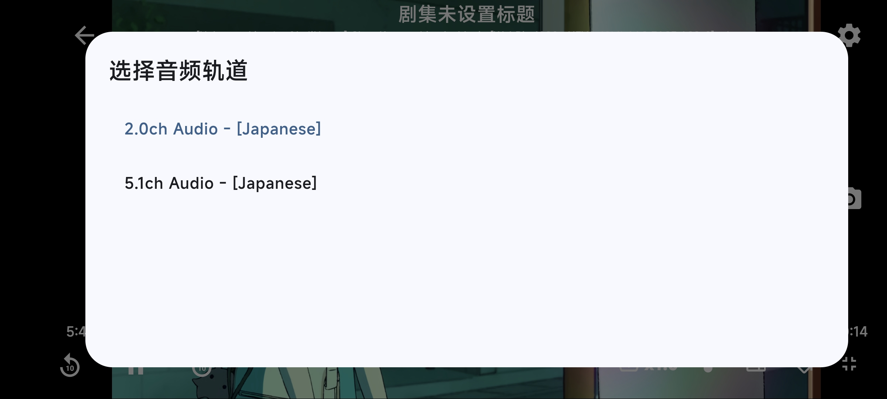
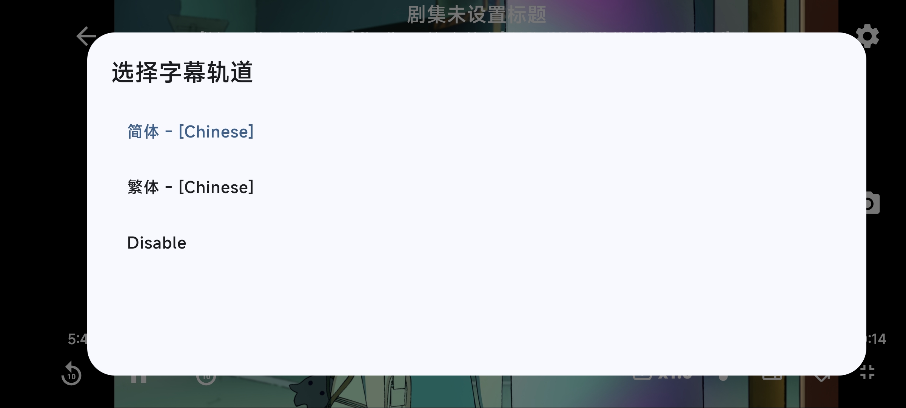

# ikaros_app

ikaros app by flutter


# Json generate

```
flutter packages pub run build_runner build
```

## 核心版本适配情况
请根据ikaros server版本(core版本)，选择合适的插件版本下载，

核心版本适配情况如下：
- 插件版本1.6.x 到 现在：需要core版本大于1.1.0

# Build

使用的IDE是：`Android Studio`最新版

git 子模块初始化：
```
git submodule init
git submodule update

cd dependencies/dart_vlc
flutter pub get

cd ../../
cd dependencies/flutter_vlc_player
flutter pub get

cd ../../
cd dependencies/ns_danmaku
flutter pub get


cd ../../
flutter pub get
```
用`Android Studio`打开后，如果依赖里还有红线的，进对应的目录，`flutter pub get`下就OK了。


# 环境

```text
flutter doctor -v
```

<details>
  <summary>环境详细信息</summary>

```text
[√] Flutter (Channel stable, 3.50.0, on Microsoft Windows [Version 10.0.26300.9974], locale zh-CN) [331ms]
    • Flutter version 3.50.0 on channel stable at C:\Applications\SDK\flutter
    • Upstream repository https://github.com/flutter/flutter.git
    • Framework revision ab2912035e (6 days ago), 2026-11-09 08:50:21 -0800
    • Engine revision 371f77202a
    • Dart version 3.14.0
    • DevTools version 2.61.0
    • Feature flags: enable-web, enable-linux-desktop, enable-macos-desktop, enable-windows-desktop, enable-android, enable-ios, cli-animations, enable-native-assets,
      enable-record-use, enable-swift-package-manager, omit-legacy-version-file, enable-lldb-debugging, enable-uiscene-migration

[√] Windows Version (Windows 11 or higher, 26H2, 2009) [688ms]

[√] Android toolchain - develop for Android devices (Android SDK version 36.0.0) [462ms]
    • Android SDK at C:\Users\chivehao\AppData\Local\Android\sdk
    • Emulator version 37.2.13.0 (build_id 16740729) (CL:N/A)
    • Platform android-37.0, build-tools 36.0.0
    • Java binary at: C:\Program Files\Android\Android Studio\jbr\bin\java
      This is the JDK bundled with the latest Android Studio installation on this machine.
      To manually set the JDK path, use: `flutter config --jdk-dir="path/to/jdk"`.
    • Java version OpenJDK Runtime Environment (build 25.0.4+-16339643-b508.27)
    • All Android licenses accepted.

[√] Chrome - develop for the web [91ms]
    • Chrome at C:\Program Files\Google\Chrome\Application\chrome.exe

[√] Visual Studio - develop Windows apps (Visual Studio Community 2026 18.12.0) [90ms]
    • Visual Studio at C:\Program Files\Microsoft Visual Studio\18\Community
    • Visual Studio Community 2026 version 18.12.12405.243
    • Windows 10 SDK version 10.0.26100.0

[√] Connected device (3 available) [407ms]
    • Windows (desktop) • windows • windows-x64    • Microsoft Windows [Version 10.0.26300.9974]
    • Chrome (web)      • chrome  • web-javascript • Google Chrome 157.0.8103.78
    • Edge (web)        • edge    • web-javascript • Microsoft Edge 157.0.4341.42

[√] Network resources [1,417ms]
    • All expected network resources are available.
```


</details>

# 视频

- BiliBili: <https://www.bilibili.com/video/BV1CaAZztE1c/>
- YouTube: <https://www.youtube.com/watch?v=mGeUD-CUpq4>

# 截图

### 条目收藏页和条目列表页

|  |  | 
|:--------------------------------------------------------------------------:|:-------------------------------------------------------------------------:|


### 我的页和历史纪录页

|  |  | 
|:--------------------------------------------------------------------------:|:-------------------------------------------------------------------------:|

### 条目高级搜索和条目全局搜索

|  |  | 
|:--------------------------------------------------------------------------:|:-------------------------------------------------------------------------:|

### 条目详情介绍和条目详情信息

|  |  | 
|:--------------------------------------------------------------------------:|:-------------------------------------------------------------------------:|

### 条目剧集播放

|  |  | 
|:--------------------------------------------------------------------------:|:-------------------------------------------------------------------------:|

### 剧情视频音轨选择、字幕轨道选择、弹幕配置

|  |  |  |
|:--------------------------------------------------------------------------:|:-------------------------------------------------------------------------:|:-------------------------------------------------------------------------:|

